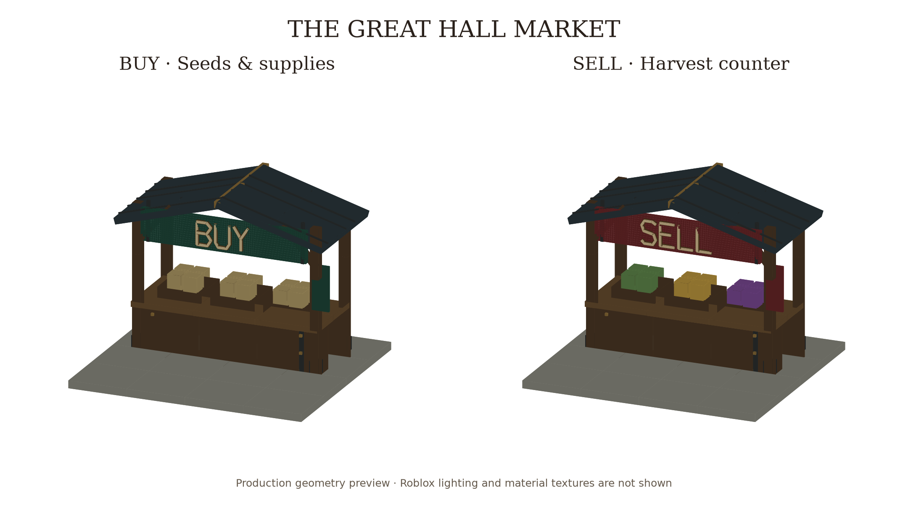

# Great Hall farm market

Two shared medieval stalls sit on either side of the hall approach at world X -29/+29, Z -184. BUY uses jade oak signage and seed pouches; SELL uses oxblood signage and crop crates. Both have slate roofs, timber knee braces, iron counter straps, brass rivets and physical raised lettering. Their collision pads leave the central avenue clear. Geometry is authored by `Server/FarmMarket.lua` and built by `SanctuaryHub` after the forge.

The everyday loop is **buy seeds → plant → harvest → sell crops**. BUY opens the seed catalogue, with explicit one/five seed purchases, owned stock, planting selection, growth time and the next locked crop. Existing bed/Sprinkler/Harvest Spirit upgrades live behind Farm supplies. SELL opens one crop list, the current server-computed total and Sell all. Neither adds a HUD destination. The courtyard's four-good stand and trough sale shortcut are removed; pet feeding remains at home.

Seeds are paid for once at purchase, then consumed from saved `Farm.SeedStock` at planting. Existing crops, seed selection, upgrades, levels, mutations, weather, pantry items and progression are retained. Manual harvest leaves an empty bed. The already-purchased Harvest Spirit retains automatic harvesting and coin-funded replanting, using owned stock first. The manual-loop preference question was optional and unanswered during implementation; the recommended simple loop was used and stated in progress updates.

Every transaction validates the live character and distance to the corresponding generated stall. Client prices/totals are ignored; existing server pricing and mutation bonuses remain authoritative. Requests use the existing token-limited RemoteFunction. Successful actions synchronize the market view. Unknown future produce remains saved, and repeated sales cannot pay twice.

The menu refinement keeps keyed rows/buttons through stock, wallet and selected-seed updates. Pending purchases show their state on the same control; callbacks read the latest row data. Selection and purchase targets are at least 44 pixels high, and the next locked crop has one explanation rather than repeated disabled purchase buttons. Growth time retains hours/minutes/seconds so watering improvements remain visible. Late loading errors cannot overwrite a newer market visit.

Verification: **40** production market/plant/automation/geometry checks, **34** menu/layout/refresh checks, **24** existing farm regressions and **22** guarded-sync checks pass. The new market/service/client modules have zero Selene errors/warnings; GameServer retains its 53 existing diagnostics with no new diagnostics. Generated production/test/sanctuary places match **116/119/119** scripts. The guarded installer preflights Client, Shared and Server sources together before any write and rolls all scopes back on failure.

`tools/render_farm_market.py` renders actual exported stall geometry. `Desktop/roblox pets/Hall_Market/stalls-preview.png` is a white-background geometry preview, not a Studio screenshot; native materials, lighting, signs at gameplay distance, collision routes and transactions still need a real playtest. Studio's shared Edit handler remains unreachable, so the Team Create save remains pending. Source sync does not itself rebuild or save the editable map; once recovered, rebuild the owned market in Edit for the shared view and test a fresh Play session.

The broader Castle Breach/pet abilities/physical forge ritual ideas remain planned. This pass prioritizes the user's specific request to simplify farming around two nearby stalls.
